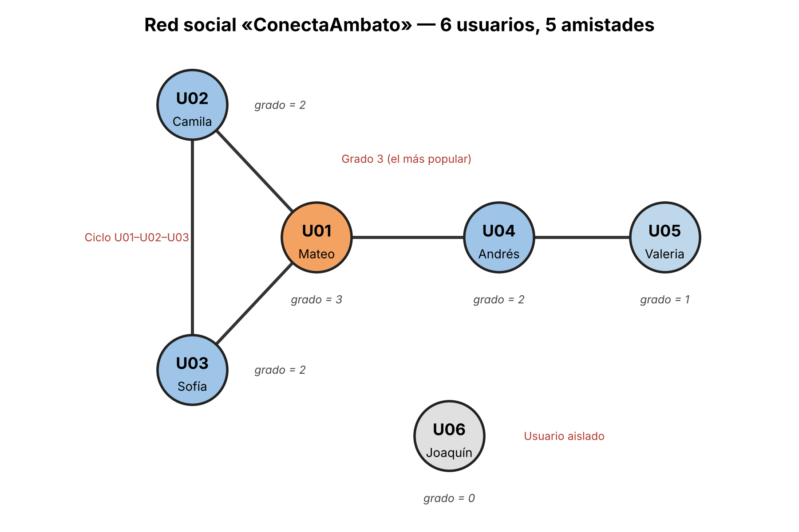

# Red social «ConectaAmbato» — Reto de grafos y vértices

Fase 1 · Grafos y vértices. Red social modelada como un grafo **simple, no dirigido y no ponderado**.

## El grafo

| Id  | Usuario | Grado |
|-----|---------|-------|
| U01 | Mateo   | 3     |
| U02 | Camila  | 2     |
| U03 | Sofía   | 2     |
| U04 | Andrés  | 2     |
| U05 | Valeria | 1     |
| U06 | Joaquín | 0 (aislado) |

Amistades (5 aristas): `U01–U02`, `U02–U03`, `U03–U01`, `U01–U04`, `U04–U05`.



## Condiciones del reto

- 6 usuarios y 5 amistades.
- Ciclo de 3 vértices: U01 – U02 – U03.
- Usuario aislado: U06 (Joaquín).
- Usuario con grado 3: U01 (Mateo).
- Sin lazos ni amistades duplicadas.

## Archivos

- `RedSocial.java`: modelo del grafo (lista de adyacencia) y verificación de las condiciones.
- `grafo_red_social.png`: dibujo del grafo.
- `Informe_Red_Social_Grafos.pdf`: informe de la tarea.
- `salida_programa.txt`: salida de la ejecución del programa.

## Compilar y ejecutar

```bash
javac RedSocial.java
java RedSocial
```
